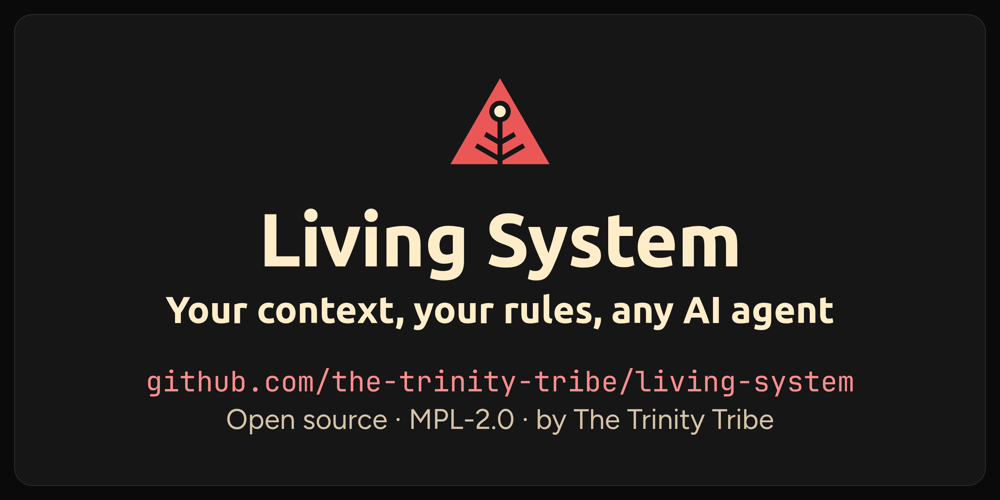
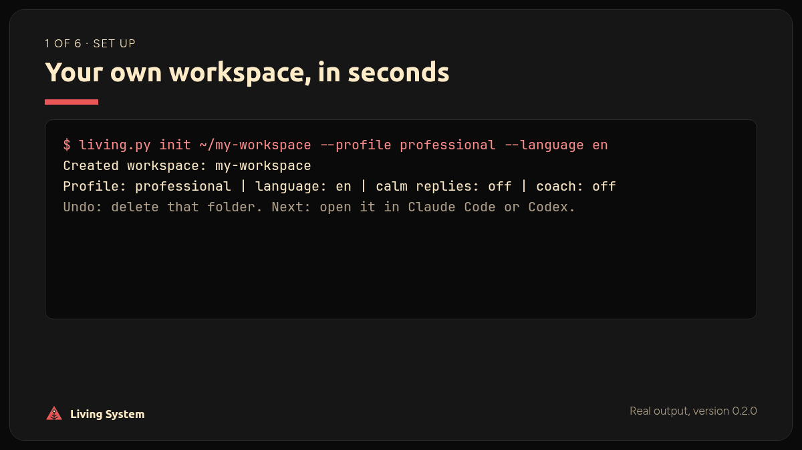
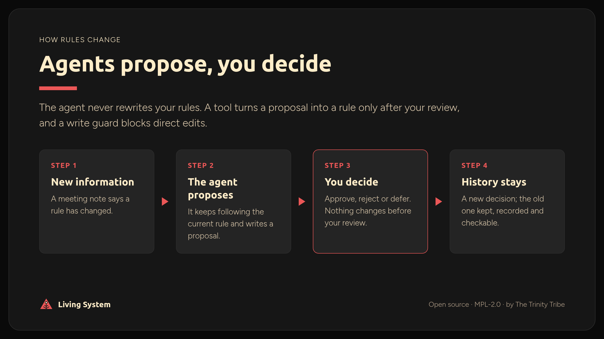
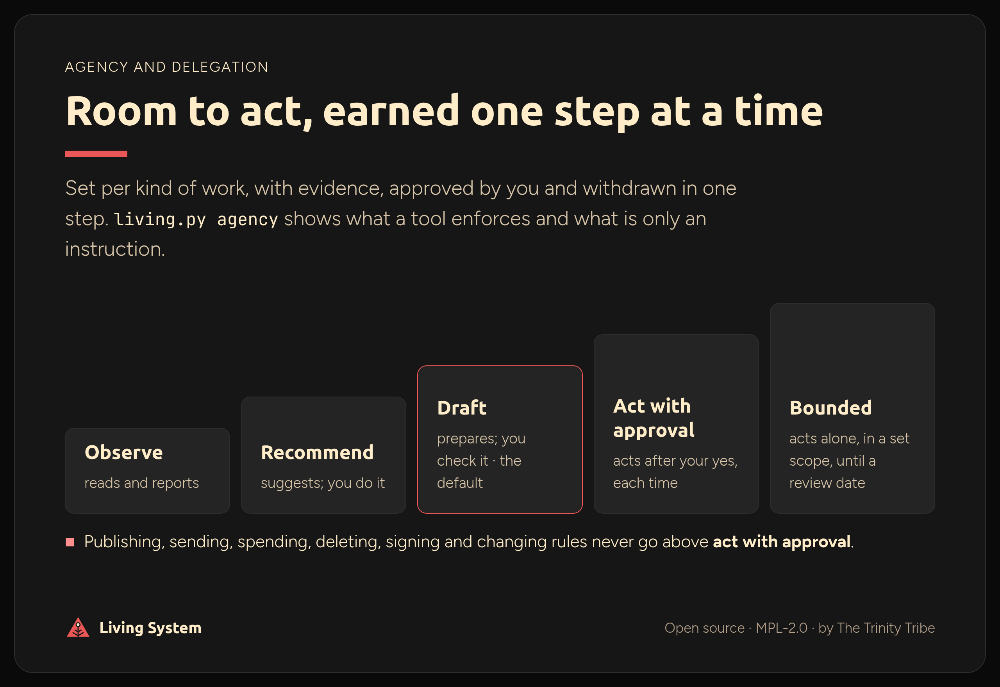
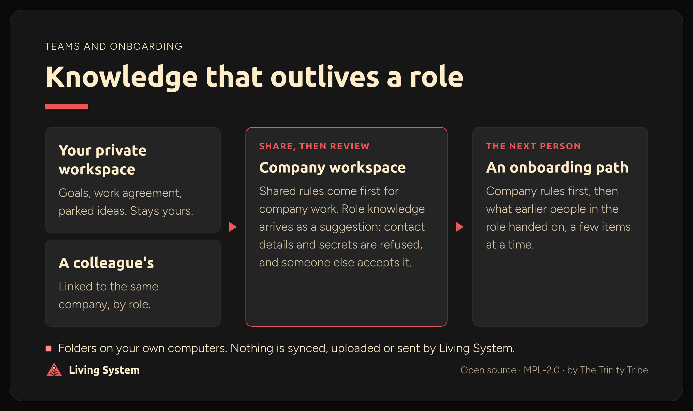
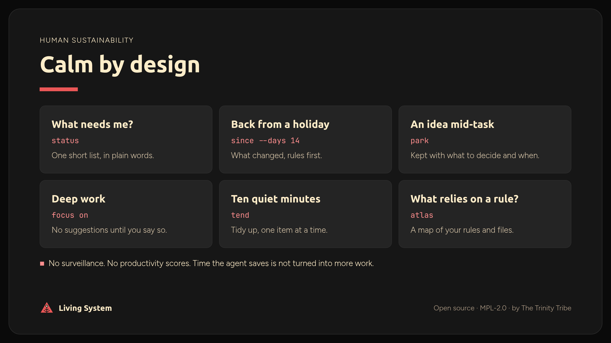

<p align="center"></p>

# Living System

**Your rules in plain files. Agents propose. People decide.**

Living System gives Claude Code and Codex a shared, written memory of how you work: your decisions, your knowledge, your boundaries. An agent can suggest a change to what you decided; it can never quietly rewrite it. Everything lives in plain Markdown on your own computer: no server, no account, no tie to one AI vendor.

<sub>Experimental · version 0.2.0 · open for testing and feedback · MPL-2.0</sub>

- **Stop re-explaining.** Your rules are written once and read by every agent session.
- **You stay the decision-maker.** Agents propose; only your review changes a rule, and a write guard blocks direct edits.
- **Room to act, earned.** Give the agent more autonomy one kind of work at a time, with evidence, and take it back in one step.
- **Knowledge that outlives a role.** Hand on what you learned without personal data; the next person gets a gentle onboarding path.
- **Calm by design.** Catch up after a holiday, park ideas without switching task, switch on focus mode. No surveillance, no scores.
- **Skills that stay yours.** The agent explains its choices, can coach you, and prints a handbook for working without AI.



<sub>Real output from version 0.2.0: a workspace, a proposal, your approval, two blocked shortcuts, and proof nothing changed afterwards.</sub>

Whether it helps *you* is something you can measure: every workspace has a 10-minute [value check](docs/features/value-check.md) you run yourself.



<sub>Read more: <a href="docs/features/decisions-and-proposals.md">Decisions and proposals</a> · click the image to open it full size</sub>



<sub>Read more: <a href="docs/features/agency.md">Agency and delegation</a> · click the image to open it full size</sub>



<sub>Read more: <a href="docs/features/connected-workspaces.md">Connected workspaces</a> · click the image to open it full size</sub>



<sub>Read more: <a href="docs/features/parking-and-tending.md">Parking, tending and focus</a> · click the image to open it full size</sub>

Created and architected by **Adrianna Mamczarz**, through **The Trinity Tribe**. Features and structure were invented and tested in her own practice; AI assisted with implementation, while design decisions, review and acceptance stayed human-led.

> **Status:** experimental and educational. Not a security boundary, an identity system or a production access-control product. The demo organisation (Moss & Circuit, Riverside Community Garden, Maya Chen, Leo, Sam) is fictional.

## Help test it

This preview is open for testing, feedback and contributions.

- **Try it:** [TESTING.md](TESTING.md) has a 30-minute path for first-time testers and what feedback helps most.
- **Tell us:** [open an issue](https://github.com/the-trinity-tribe/living-system/issues/new/choose) and choose *Feedback*, *Bug* or *Idea*. Plain words are perfect; you do not need to be technical.
- **Contribute:** [CONTRIBUTING.md](CONTRIBUTING.md). Security problems: [SECURITY.md](SECURITY.md) (please report privately).

## Three things to keep apart

| | What it is | Where |
| --- | --- | --- |
| **The product** | Templates, tools, modules and docs. Public. | This repository. |
| **Your workspace** | Your own private folder, made by `init`. | A separate folder **outside** this repository. |
| **The demo** | A fictional sandbox to explore. | [demo/moss-and-circuit/](demo/moss-and-circuit/) |

Your workspace lives in its own folder on purpose: personal data should never sit inside a clone of a public repository.

## Quick start

**You need:** Git and Python 3.10 or newer. Nothing else to install, no accounts. To work with an agent you also need [Claude Code or Codex](docs/ai-tools.md).

```sh
git clone https://github.com/the-trinity-tribe/living-system.git
cd living-system
```

**On Windows**, type `py` wherever this page says `python3`. If `py` is not found, install Python from python.org and tick "Add python.exe to PATH".

**Set up your workspace with an agent (easiest):** open this folder in Claude Code or Codex and say *"Read INSTALL.md and set up my workspace."* It asks a few short questions, shows exactly what it will create, and waits for your yes. See [INSTALL.md](INSTALL.md).

**Or by hand:**

```sh
python3 tools/living.py init ~/my-workspace --profile professional --language en
python3 tools/living.py status ~/my-workspace
```

Profiles: `student`, `professional`, `employee`, `manager`. Languages with starter files: `en`, `de`, `pl`. Options: `--calm-replies` (short, plain answers), `--coach` (help keeping your own skills), `--team` (a shared company workspace). `init` refuses a folder that already has files, and leaves nothing behind if it fails. To undo, delete the folder.

Then open **your workspace** in Claude Code or Codex and work as usual. Your starter `SYSTEM.md` and `PRINCIPLES.md` are drafts until you change them to `status: approved` yourself. Tip: say *"Help me make my first decision from my setup answers."*

Run `python3 tools/living.py` on its own for a short menu of everyday commands. All commands: [command reference](docs/cli.md). Stuck? [Troubleshooting](docs/troubleshooting.md). How it fits together: [architecture](docs/architecture.md).

## What you can do

Every feature has a plain-language page answering the same ten questions. Full index: [docs/](docs/README.md).

| For | Feature | In one line |
| --- | --- | --- |
| Every day | [Status](docs/features/status.md) | What needs your attention, in plain words. |
| | [Catch-up](docs/features/catch-up.md) | What changed while you were away, changed rules first. |
| | [Handover note](docs/features/handover-note.md) | The next session continues where the last one stopped. |
| | [Parking, tending, focus](docs/features/parking-and-tending.md) | Park an idea without switching task; tidy up one item at a time; a focus mode with no suggestions. |
| Your rules | [Decisions and proposals](docs/features/decisions-and-proposals.md) | Agents propose; your review creates, replaces or retires a rule. |
| | [Review record](docs/features/review-record.md) | Shows if an approved rule was changed afterwards. |
| | [Write guard](docs/features/write-guard.md) | Blocks agent edits to your rules, approvals and secrets. |
| | [Outside material and secrets](docs/features/outside-material-and-secrets.md) | E-mails and documents from others are information, never instructions; a scan finds hidden ones. |
| You | [Personal work agreement](docs/features/work-agreement.md) | Your own plain-text terms for how AI works with you, including what saved time is for. |
| | [Agency and delegation](docs/features/agency.md) | Who may do what, honestly labelled; delegation levels you grant and withdraw per kind of work. |
| Learning | [Learning mode](docs/features/learning-mode.md) | The agent explains, coaches on request, quizzes you on your rules, and prints a handbook for working without AI. |
| | [Onboarding path](docs/features/onboarding.md) | A private reading path through what matters, a few items at a time. |
| Teams | [Connected workspaces](docs/features/connected-workspaces.md) | A shared company workspace and private personal ones; role knowledge is handed on without personal data. |
| Repeated work | [Third-Run counter](docs/features/third-run-counter.md) | Counts repeated work and asks at the third time whether to automate it. |
| | [Modules](docs/features/modules.md) and [workflow generator](docs/features/workflow-generator.md) | Optional ready-made workflows, or your own staged ones. |
| | [Atlas](docs/features/atlas.md) | A map of which rules are in force and what relies on them. |
| Upkeep | [Doctor](docs/features/doctor.md), [upgrade](docs/features/upgrade.md), [export](docs/features/export.md) | Health check, safe updates, one-file backups you can check. |
| | [Obsidian or any editor](docs/features/obsidian.md) | Read and approve in a note app. |
| Showing value | [Value check](docs/features/value-check.md) and [making the case](docs/champions.md) | Measure it yourself; argue for it honestly with a counts-only evidence summary. |

## Optional modules

Nothing is installed unless you ask, and every command shows a plan before `--apply`.

| Module | What it gives you |
| --- | --- |
| `weekly-update` | A three-step weekly update. You send it. |
| `meeting-notes` | Meeting notes become clean notes, actions and proposals. |
| `staged-learning` | The agent suggests lessons from its mistakes; only approved ones are used. |
| `knowledge-inbox` | Knowledge worth keeping, with its source; old facts flagged for a re-check. |
| `second-check` | Important work is checked by a fresh session before you decide. |
| `careful-run` | Bigger or riskier work in six checked steps, with a run card you can pause and resume safely. |
| `work-audit` | Look at how work really happens before adding AI; test one small change. |
| `research-review` | Answer a question from dated sources, with conflicts and gaps listed. |
| `client-intake` | A new client request becomes what they need, what is unknown and one next step. |
| `content-prep` | A post or newsletter: brief, draft, fact and tone check; you publish. |
| `small-experiment` | Try one change, measure it the same way before and after, then keep, revise or revert it. |

```sh
python3 tools/living.py modules --workspace ~/my-workspace
python3 tools/living.py add ~/my-workspace weekly-update          # see the plan
python3 tools/living.py add ~/my-workspace weekly-update --apply  # install it
```

`add` never overwrites a file. `remove` deletes only files you have not edited, and never touches your decisions, proposals or projects.

## Explore the demo

```sh
python3 -B tools/review.py --root demo/moss-and-circuit current
python3 -B tools/review.py --root demo/moss-and-circuit history
python3 -B -m unittest discover tests
```

The demo shows one rule's whole life: contradictory evidence, a proposal, a human review, a new decision, and the old one kept as history. Start at [demo/moss-and-circuit/AGENTS.md](demo/moss-and-circuit/AGENTS.md); for a 10-minute live demo on temporary copies, see [demo/WALKTHROUGH.md](demo/WALKTHROUGH.md). **Do not run `review` against the shipped demo**; it changes files.

## Current scope and limitations

- **No login, no identity check.** Names in approvals (`--by`, `approved_by`) are labels, not proof of who someone is.
- **Agent rules are instructions.** The write guard enforces the most important ones in Claude Code, and in Codex once you trust its hooks. Everything else, and anything changed outside the agent, is not enforced. Scans recognise common patterns, not every trick.
- **Agent behaviour is less tested than the tools.** Over 400 automated tests cover the tools on Linux, Windows and macOS. Skills and coaching are instructions to the agent; live sessions are recorded in [demo/WALKTHROUGH.md](demo/WALKTHROUGH.md), and this preview asks testers to try them.
- **Languages.** Starter files in English, German and Polish (a native-speaker review would help). Agent rule files and tool messages are English.
- **Not measured:** time or money saved, and energy use. See [local-first](docs/local-first.md).
- What it will not do, and which guardrails a tool enforces: [ethics](docs/ethics.md).
- What is planned, deferred or rejected, with reasons: [roadmap](docs/roadmap.md).

## Licensing, community and credit

Distributed under the **[Mozilla Public License 2.0](LICENSE)** (`MPL-2.0`). Covered modifications you distribute are subject to the licence. Your own workspace content is not MPL-covered merely because you use Living System. Read the licence for the exact terms.

Copyright © 2026 Adrianna Mamczarz. The Trinity Tribe is the project home. Influences and the ICM method are credited in [CREDITS.md](CREDITS.md). If you build on this work, please credit the creator and contributors; cite it with [CITATION.cff](CITATION.cff). Forks and independent implementations are welcome, but should not imply official approval or affiliation with The Trinity Tribe.
