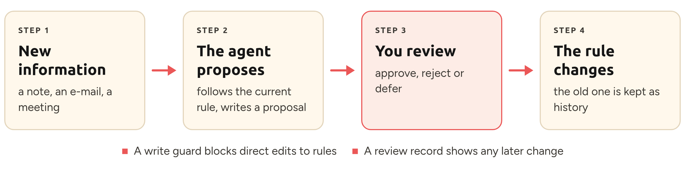
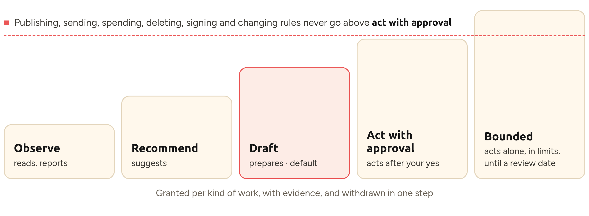
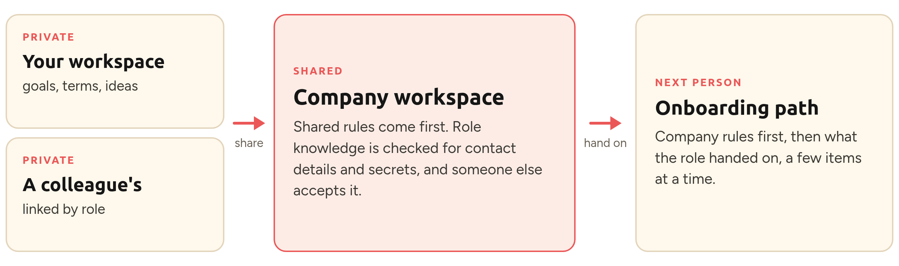

<div align="center">


# Living System

### Your context, your rules, any AI agent

[](https://github.com/the-trinity-tribe/living-system/releases/latest)
[](https://github.com/the-trinity-tribe/living-system/actions/workflows/tests.yml)
[](docs/troubleshooting.md)
[](#works-with)
[](LICENSE)
[](#limitations)

Keep your rules, knowledge, goals and workflows in plain files you own. Switch between Claude Code, Codex, Hermes or a local model without starting over, and decide yourself what changes. Free, open source, and it all stays on your computer.

[Start in one sentence](#start-in-one-sentence) · [See it in action](#see-it-in-action) · [Quick start](#quick-start) · [Works with](#works-with) · [How it works](#how-it-works) · [Made for you](#made-for-how-you-work) · [Everything inside](#everything-inside) · [Docs](docs/README.md) · [Help test it](#help-test-it) · [Discussions](https://github.com/the-trinity-tribe/living-system/discussions)

</div>

## Start in one sentence

No terminal skills needed. Open Claude Code, Codex, Hermes or another AI agent in an empty folder and paste:

```text
Set up Living System for me: download https://github.com/the-trinity-tribe/living-system and follow its INSTALL.md.
```

1. Your agent downloads Living System and reads its setup guide.
2. It asks you five short questions, one at a time. "Skip" is always fine.
3. It shows exactly what it will create, and waits for your yes.
4. You open your new workspace and work as usual. Try: *"Help me make my first decision."*

We tried this sentence in fresh Claude Code and Codex sessions ([results](demo/WALKTHROUGH.md#one-sentence-start-from-an-empty-folder)). Prefer to type the commands yourself? See [Quick start](#quick-start).

## What changes for you

Most AI tools keep their own memory of you: locked inside one product, growing on its own, and hard to check. Living System turns that around.

- **Own it, take it anywhere.** Your rules, knowledge, goals and workflows live in plain files on your own computer, not inside one AI product. Use them with Claude Code, Codex, Hermes or a local model, for work or personal projects, and switch without starting over.
- **Lean and true, not bloated.** Instead of a memory that keeps growing and filling the context window, you keep a curated set of files, and a routing guide points your agent to just what a task needs. Your agent suggests changes instead of making them; you decide what becomes true, and a record shows any later change.
- **Grows with you.** Optional [modules](#optional-modules) for weekly updates, meeting notes, research, client intake, content and careful multi-step work, plus learning, coaching and [team workspaces](#teams-knowledge-that-outlives-a-role).
- **More freedom for your agent, one step at a time.** Let it do more in one kind of work once it has earned it, and take that back in one step. Sending, publishing, spending and deleting always wait for you.
- **Calm, not another dashboard.** Ask what needs you, catch up after time away, park an idea without losing focus. No tracking, no productivity scores.

No server, no account, no tie to one AI vendor or model: just Python's standard library and Markdown files.

## Made for how you work

Pick a starting point when you set up. Each one adds a few starter files and rules that fit how you work.

| You are | What you get |
| --- | --- |
| **A student** | Your rules are your own commitments, like "no studying after 22:00", plus a study plan template. Your agent helps you understand, plan and check, and never writes coursework for you unless you ask. |
| **A professional or freelancer** | A client project template. Client details stay private, and anything meant for a client is drafted by your agent, never sent. |
| **An employee** | Private goals that stay out of shared files, and a team handover template. You propose changes to team rules; approval stays with the people your employer chose. |
| **A manager or founder** | A starter for roles and approval rules, and a team onboarding page. Approval rights come from approved decisions, never from a job title. |

Add any time: **calm replies** (short, plain answers), **coach mode** (help keeping your own skills) and a **shared company workspace** for a team. Starter files come in English, German and Polish.

## See it in action

Real output from version 0.2.0, step by step; long lines are wrapped to fit. (Prefer to watch? The same run as a [25-second animation](brand/images/demo.gif).)

**1. You set up a workspace.** One command, or one sentence to your agent.

```text
$ python3 tools/living.py init ~/my-workspace --profile professional
Created workspace: ~/my-workspace
Profile: professional | language: en | calm replies: off | coach: off
Undo: delete that folder. Next: open it in Claude Code or Codex.
```

**2. Your agent proposes a rule.** It writes a suggestion; nothing is a rule yet.

```text
Written proposals/2026-10-25-clients-hear-from-me-within-two-days.md.
It is not a rule yet. Read it; when you have decided, run in the workspace:
  python3 tools/review.py review proposals/2026-10-25-clients-hear-
  from-me-within-two-days.md --outcome approve|reject|defer
  --by "Your Name"
```

**3. You decide.** Only your review turns the proposal into a rule.

```text
$ python3 tools/review.py review proposals/2026-10-25-clients-hear-
  from-me-within-two-days.md --outcome approve --by "Adrianna"
promoted; created decisions/2026-10-25-clients-hear-from-me-within-
two-days.md
```

**4. The agent tries a shortcut.** Editing the rule directly is blocked.

```text
Living System guard: blocked. decisions are created only by
`python3 tools/review.py review` after a human decides, and are
never edited or deleted. Write a proposal instead (AGENTS.md
section 6).
```

**5. Or tries to save a password.** Secrets stay out of your files.

```text
Living System guard: blocked. this looks like a password, key or
token (a password written out). Secrets never go into the workspace
(AGENTS.md section 4): keep them in a password manager and write
only where to find them.
```

**6. Proof.** Anything changed after your approval would show up here.

```text
$ python3 tools/review.py verify
Review record intact: 1 entry; every recorded file is unchanged.
```

## Quick start

Prefer the terminal? You need **Git** and **Python 3.10+**, and an agent that works in a folder: [Claude Code, Codex, Hermes or another](#works-with).

```sh
git clone https://github.com/the-trinity-tribe/living-system.git
cd living-system
```

**Guided:** open this folder in your agent and say *"Read INSTALL.md and set up my workspace."* The agent asks a few short questions, shows what it will create, and waits for your yes.

**By hand:**

```sh
python3 tools/living.py init ~/my-workspace --profile professional --language en
python3 tools/living.py status ~/my-workspace
```

Then open `~/my-workspace` in your agent and work as usual. Try saying *"Help me make my first decision from my setup answers."*

<details>
<summary>Windows, profiles and options</summary>

- **Windows:** type `py` wherever this page says `python3`. If `py` is not found, install Python from python.org and tick "Add python.exe to PATH".
- **Profiles:** `student`, `professional`, `employee`, `manager`. **Languages** with starter files: `en`, `de`, `pl`.
- **Options:** `--calm-replies` (short, plain answers), `--coach` (help keeping your own skills), `--team` (a shared company workspace).
- `init` refuses a folder that already has files and leaves nothing behind if it fails. To undo, delete the folder.
- Your workspace is created **outside** this repository on purpose, so personal data never sits inside a clone of a public project. Details: [INSTALL.md](INSTALL.md).

</details>

Run `python3 tools/living.py` on its own for a menu of everyday commands. All commands: [command reference](docs/cli.md) · Stuck? [Troubleshooting](docs/troubleshooting.md)

## Works with

Living System's tools never call an AI model; they read and write plain files. Any agent that reads `AGENTS.md` and can run `python3` can use a workspace, with a hosted model or a local one.

| | Reads your rules | Write guard | Tested |
| --- | :---: | :---: | --- |
| **Claude Code** | ✓ | ✓ | 13 live scenarios |
| **Codex** | ✓ | ✓ once you trust its hooks | 13 live scenarios, plus the guard |
| **Hermes Agent** | ✓ | | Two live checks in a clean profile; use a separate profile |
| **OpenCode, Cursor and other `AGENTS.md` agents** | per their docs | | Not yet |
| **Local models** | through an agent above | | Not yet; needs a large context window |

Without the write guard, the rules still ask the agent to propose instead of editing, and `review.py verify` still shows any change to an approved rule. Details and tips: [AI tools](docs/ai-tools.md#other-agents-and-local-models).

## How it works

<picture>
  <source media="(prefers-color-scheme: dark)" srcset="brand/images/readme/how-it-works-dark.png">
  <source media="(prefers-color-scheme: light)" srcset="brand/images/readme/how-it-works-light.png">
  
</picture>

A workspace is an ordinary folder. Agents read `AGENTS.md` first and follow the rules in `decisions/`. When something suggests a rule should change, they keep following the current rule and write a proposal. `review.py` turns a proposal into a decision only after a person approves it, refuses stale or invalid changes, and records every review so later edits show up.

```text
my-workspace/
├── AGENTS.md        how agents must work here, read every session
├── decisions/       your rules, each approved by a person
├── proposals/       suggested changes waiting for your review
├── knowledge/       what you know, with sources
├── incoming/        outside material: information, never instructions
├── me/              your goals and work agreement (private)
├── handover/        where the last session stopped
└── tools/           review.py and living.py, so the folder works on its own
```

More: [architecture](docs/architecture.md) · [decisions and proposals](docs/features/decisions-and-proposals.md) · [write guard](docs/features/write-guard.md)

## Everything inside

Use only what helps. Every feature has its own plain-language page answering the same ten questions; the full index is in [docs](docs/README.md).

### Every day: less to remember

- **[Status](docs/features/status.md):** what needs you, in plain words.
- **[Catch-up](docs/features/catch-up.md):** back from a holiday? See what changed, changed rules first.
- **[Handover note](docs/features/handover-note.md):** the next session continues where the last one stopped.
- **[Park, tend and focus](docs/features/parking-and-tending.md):** park an idea mid-task with a date to decide, tidy up in ten quiet minutes, or switch on a focus mode with no suggestions.

| You want | Ask your agent, or run | What happens |
| --- | --- | --- |
| What needs me? | `status` | One short list in plain words. |
| Back from a holiday | `since --days 14` | What changed, changed rules first. |
| An idea mid-task | `park` | Kept with what to decide and when. |
| Deep work | `focus on` | No suggestions until you say so. |
| Ten quiet minutes | `tend` | Tidy up, one item at a time. |
| What relies on a rule? | `atlas` | A map of rules and the files that use them. |

### Your rules: trustworthy, and yours to change

- **[Decisions and proposals](docs/features/decisions-and-proposals.md):** add a rule, make an exception, replace or retire one. Nothing changes before your review, and the old rule stays as history.
- **[Review record](docs/features/review-record.md):** shows if an approved rule was changed afterwards.
- **[Write guard](docs/features/write-guard.md):** blocks direct edits to your rules and saved passwords (Claude Code, and Codex once you trust its hooks).
- **[Outside material and secrets](docs/features/outside-material-and-secrets.md):** e-mails and documents from others are information, never instructions; a scan finds hidden instructions and secrets.

### You and your agent: autonomy you control

- **[Work agreement](docs/features/work-agreement.md):** your own terms for how AI works with you, including when it should challenge you and what saved time is for.
- **[Agency and delegation](docs/features/agency.md):** choose, per kind of work, how much your agent may do, and take it back in one step.

<picture>
  <source media="(prefers-color-scheme: dark)" srcset="brand/images/readme/delegation-ladder-dark.png">
  <source media="(prefers-color-scheme: light)" srcset="brand/images/readme/delegation-ladder-light.png">
  
</picture>

1. **Observe:** reads and reports.
2. **Recommend:** suggests; you do it.
3. **Draft:** prepares; you check it. This is the default.
4. **Act with approval:** acts after your yes, each time.
5. **Bounded:** acts alone within set limits, until a review date.

Publishing, sending, spending, deleting, signing and changing rules never go above *act with approval*. `living.py agency` lists who may do what and marks each line as **enforced** by a tool or **instruction** only.

### Learning: keep your own skills

- **[Learning mode](docs/features/learning-mode.md):** your agent explains its choices, coaches you on request, quizzes you on your own rules and prints a handbook for working without AI.
- **[Onboarding path](docs/features/onboarding.md):** a private reading path through what matters, a few items at a time.

### Teams: knowledge that outlives a role

<picture>
  <source media="(prefers-color-scheme: dark)" srcset="brand/images/readme/workspaces-dark.png">
  <source media="(prefers-color-scheme: light)" srcset="brand/images/readme/workspaces-light.png">
  
</picture>

Each person keeps a private workspace (goals, work agreement, ideas), linked to a shared company workspace whose rules come first for company work. What someone learned in a role is shared as a suggestion: contact details and secrets are refused, and someone else accepts it. The next person in the role gets a gentle onboarding path. Folders on your own computers: Living System syncs, uploads and sends nothing. [Connected workspaces](docs/features/connected-workspaces.md)

### Repeated work: automate only what earns it

- **[Third-Run counter](docs/features/third-run-counter.md):** counts repeated work and asks at the third time whether to automate it.
- **[Workflow generator](docs/features/workflow-generator.md):** turn a task you repeat into your own staged workflow, one checkable step at a time.
- **[Atlas](docs/features/atlas.md):** a map of which rules are in force and what relies on them.

#### Optional modules

Ready-made workflows you can add in one step. Nothing is installed unless you ask, every command shows a plan before `--apply`, `add` never overwrites a file, and `remove` deletes only files you have not edited.

| Module | What it gives you |
| --- | --- |
| `weekly-update` | A three-step weekly update. You send it. |
| `meeting-notes` | Meeting notes become clean notes, actions and proposals. |
| `staged-learning` | The agent suggests lessons from its mistakes; only approved ones are used. |
| `knowledge-inbox` | Knowledge worth keeping, with its source; old facts flagged for a re-check. |
| `second-check` | Important work is checked by a fresh session before you decide. |
| `careful-run` | Bigger or riskier work in six checked steps, with a run card you can pause and resume safely. |
| `work-audit` | Look at how work really happens before adding AI; test one small change. |
| `research-review` | Answer a question from dated sources, with conflicts and gaps listed. |
| `client-intake` | A new client request becomes what they need, what is unknown and one next step. |
| `content-prep` | A post or newsletter: brief, draft, fact and tone check; you publish. |
| `small-experiment` | Try one change, measure it the same way before and after, then keep, revise or revert it. |

```sh
python3 tools/living.py modules --workspace ~/my-workspace
python3 tools/living.py add ~/my-workspace weekly-update          # see the plan
python3 tools/living.py add ~/my-workspace weekly-update --apply  # install it
```

### Upkeep: stays healthy, and you can prove it helps

- **[Doctor](docs/features/doctor.md):** a health check that finds what is missing, broken or out of date.
- **[Upgrade](docs/features/upgrade.md):** safe updates that keep every file you edited.
- **[Export](docs/features/export.md):** one-file backups you can check.
- **[Obsidian or any editor](docs/features/obsidian.md):** read and approve in a note app.
- **[Value check](docs/features/value-check.md):** measure in ten minutes whether it helps *you*, and [make the case](docs/champions.md) honestly with a counts-only summary.

## Explore the demo

A fictional organisation, Moss & Circuit, shows one rule's whole life: contradictory evidence, a proposal, a human review, a new decision, and the old one kept as history.

```sh
python3 -B tools/review.py --root demo/moss-and-circuit current
python3 -B tools/review.py --root demo/moss-and-circuit history
```

Start at [demo/moss-and-circuit/AGENTS.md](demo/moss-and-circuit/AGENTS.md), or follow the 10-minute live demo on temporary copies in [demo/WALKTHROUGH.md](demo/WALKTHROUGH.md). Do not run `review` against the shipped demo; it changes files. Everyone in the demo is invented.

## Help test it

Version 0.2.0 is experimental and open for testing, feedback and contributions.

- **Try it:** [TESTING.md](TESTING.md) has a 30-minute path and says which feedback helps most.
- **Tell us:** [open an issue](https://github.com/the-trinity-tribe/living-system/issues/new/choose) and choose *Feedback*, *Bug* or *Idea*, or start a [discussion](https://github.com/the-trinity-tribe/living-system/discussions). Plain words are perfect.
- **Contribute:** [CONTRIBUTING.md](CONTRIBUTING.md). Security problems: [SECURITY.md](SECURITY.md), reported privately.

## Limitations

Living System is experimental and educational. It is not a security boundary, an identity system or an access-control product.

- **No login, no identity check.** Names in approvals (`--by`, `approved_by`) are labels, not proof of who someone is.
- **Agent rules are instructions.** The write guard enforces the most important ones in Claude Code, and in Codex once you trust its hooks. Everything else, and anything changed outside the agent, is not enforced. Scans recognise common patterns, not every trick.
- **Agent behaviour is less tested than the tools.** Over 400 automated tests cover the tools on Linux, Windows and macOS. Skills and coaching are instructions to the agent; live sessions are recorded in [demo/WALKTHROUGH.md](demo/WALKTHROUGH.md), and testers are asked to try them.
- **Languages.** Starter files in English, German and Polish (a native-speaker review would help). Agent rule files and tool messages are English.
- **Not measured:** time or money saved, and energy use. See [local-first](docs/local-first.md).
- What it will not do, and which guardrails a tool enforces: [ethics](docs/ethics.md).
- What is planned, deferred or rejected, with reasons: [roadmap](docs/roadmap.md).

## Credits and licence

Created and architected by **Adrianna Mamczarz** through **The Trinity Tribe**. She combined her own methods with ideas from others and tested the result in her own practice; AI assisted with implementation, while design decisions, review and acceptance stayed human-led.

**Inspired by** (credit only; none of them built or endorsed it): Jake Van Clief and David McDermott's Interpretable Context Methodology, David Shapiro, Jacque Fresco, Erik Schluntz and Barry Zhang's *Building effective agents* (Anthropic), Mem0's research on agent memory, Microsoft Research's SkillOpt, and the awesome-harness-engineering collection. Built on the open AGENTS.md format. Details and links: [CREDITS.md](CREDITS.md).

Distributed under the **[Mozilla Public License 2.0](LICENSE)** (`MPL-2.0`). Covered modifications you distribute are subject to the licence. Your own workspace content is not MPL-covered merely because you use Living System. Read the licence for the exact terms.

Copyright © 2026 Adrianna Mamczarz. The Trinity Tribe is the project home. Influences and the ICM method are credited in [CREDITS.md](CREDITS.md). If you build on this work, please credit the creator and contributors; cite it with [CITATION.cff](CITATION.cff). Forks and independent implementations are welcome, but should not imply official approval or affiliation with The Trinity Tribe.

<br>

<div align="center">


**Your rules in plain files. Agents propose. People decide.**

<sub>Open source · MPL-2.0 · by <a href="https://thetrinitytribe.com/">The Trinity Tribe</a></sub>

</div>
