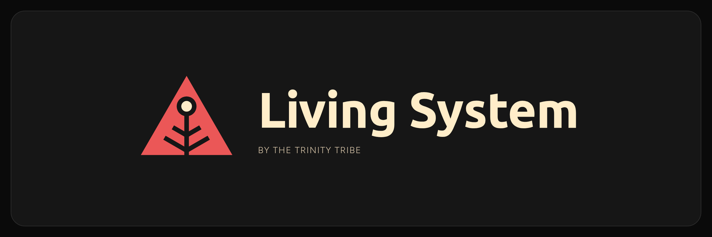

# Living System brand

Living System's look is a direct sibling of **The Trinity Tribe**'s design system, Solaris: a warm near-black ground, cream type, and one brand red used for marks, never for body text.

## The mark

[`mark.svg`](mark.svg) (vector) and [`mark-512.png`](mark-512.png).

The red triangle comes from The Trinity Tribe's logo. Inside it, a vein is cut out like a leaf or a young tree: a system that grows. The single cream dot where the vein starts is the person at its centre, the one who decides. It follows the Trinity Tribe icon rules: a 140-unit grid, filled red shapes with details cut out in 6-unit gaps, and exactly one small cream accent.

On dark grounds (`#161616` or darker) the dot is cream; on light grounds it is charcoal (`#161616`), so it always stays visible. `mark.svg` switches by itself with the viewer's light or dark setting. Keep clear space of at least a quarter of its width around it. Do not recolour, outline, rotate or add effects.

## Colours

| Role | Hex | Use |
| --- | --- | --- |
| Ground | `#161616` | Page and image background |
| Lifted surface | `#242424` | Cards |
| Border | `#2D2D2D` | 1px structural borders, no shadows |
| Cream | `#FFEDC9` | Headings and body text, the mark's accent |
| Soft cream | `#D6C4A8` | Secondary text |
| Brand red | `#EB5757` | The mark, divider rules, highlights. Never text |
| Link red | `#FF8E8E` | Links and small code accents only |

## Type

- **Ubuntu 700** for headings and the wordmark.
- **Figtree 300** for body text; uppercase with wide letter spacing for small labels.
- A monospace face for commands and file names.

Headings do not end in a full stop. Every section heading carries a short red rule beneath it (80 by 8 units).

## Images

| File | Shows |
| --- | --- |
| [`images/hero.png`](images/hero.png) | Mark, name and the headline "Your context, your rules, any AI agent", large enough to read in a link preview. 1280 by 640 (2560 by 1280 file), used as the GitHub social preview |
| [`images/readme/`](images/readme/) | Three diagrams for the README (how a rule changes, delegation levels, connected workspaces), each in a dark and a light variant on a transparent ground. Each one sits next to text that says the same thing, so no reader depends on the picture |
| [`images/mark-lockup.png`](images/mark-lockup.png) | Mark and name together |
| [`images/demo.gif`](images/demo.gif) | A 25-second loop of real output: setup, a proposal, approval, two blocked shortcuts, proof nothing changed |

Every image describes features that exist in the current release; nothing in them is a mock-up of something planned. They were rendered from HTML at twice their size for sharp display.

Images support the text; they do not replace it. Diagrams carry a few words each, and anything a reader needs to act on stays in the README as real text.

## Where it is used

- The README mark and diagrams (GitHub picks the dark or light variant to match the reader's theme). The README headline and the "See it in action" walkthrough are real text, so they stay readable on phones; the demo animation is linked, not embedded.
- The pitch page, [`site/index.html`](../site/index.html): dark by default; people whose device asks for light get a warm cream version with the same red and type.

## Credit

Design language: The Trinity Tribe's Solaris design system. The fonts are Ubuntu (Ubuntu Font Licence) and Figtree (SIL Open Font Licence); they are used in the images but not included in this repository. The mark and images are part of Living System and fall under the repository licence (MPL-2.0); the name and look belong to The Trinity Tribe, so forks should use their own.
